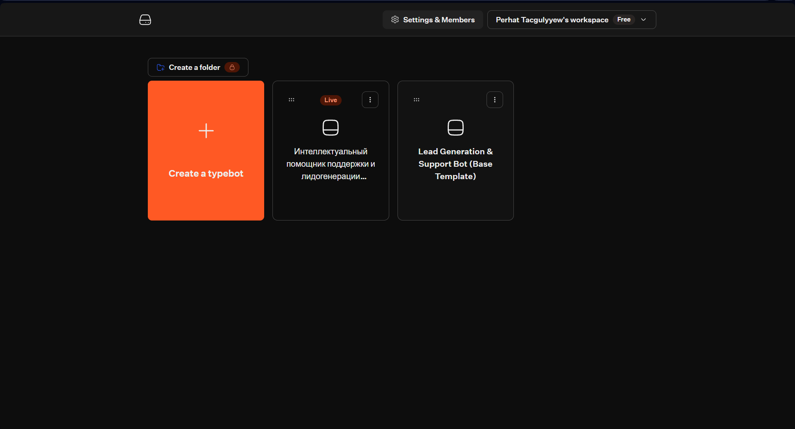
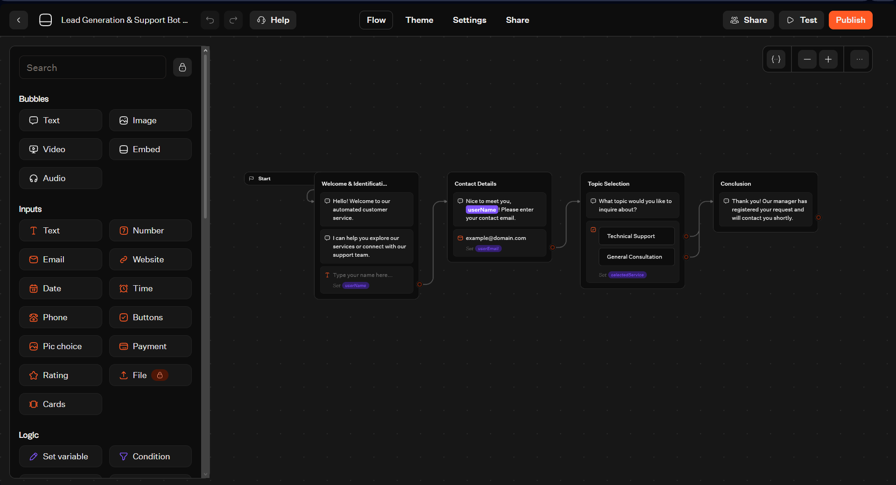
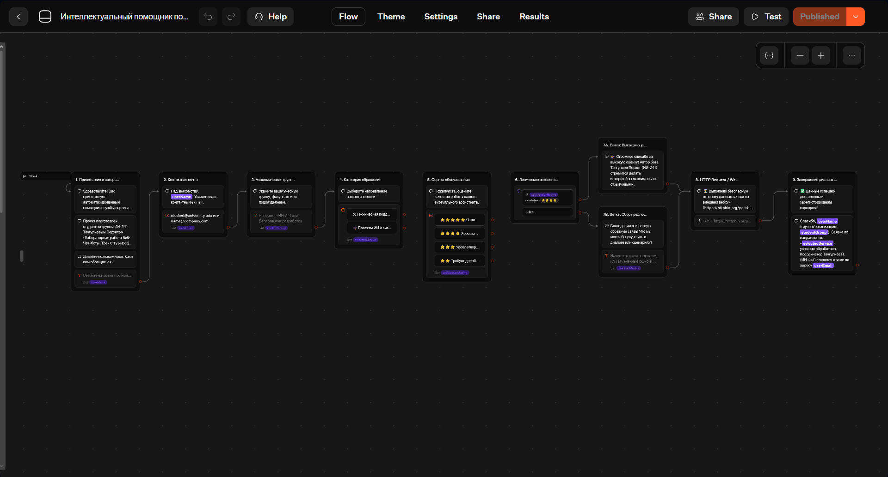
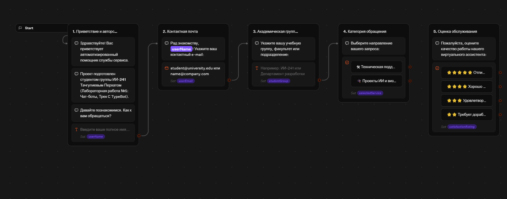
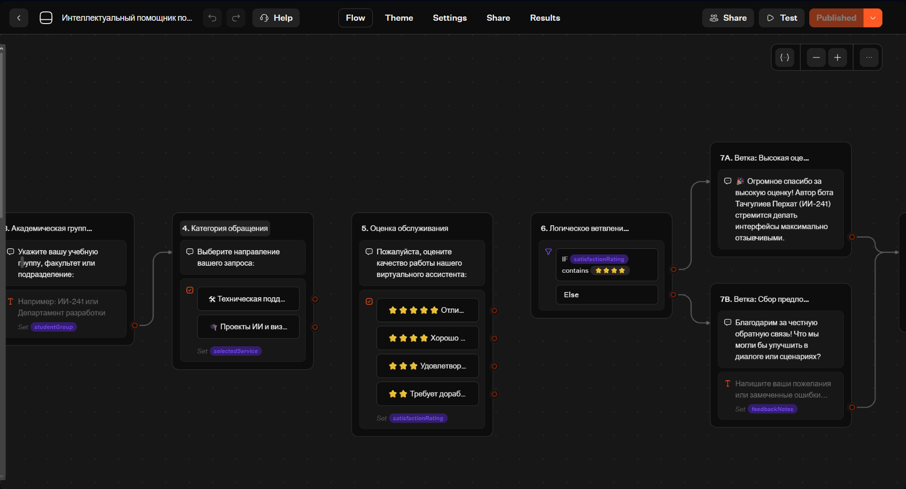
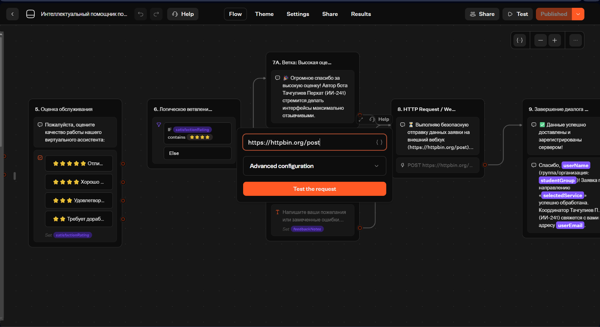
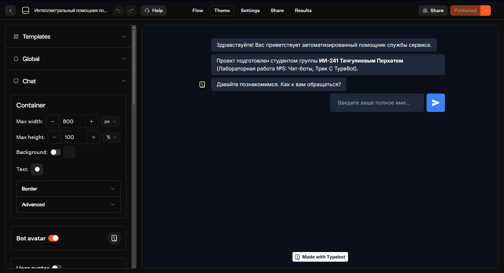
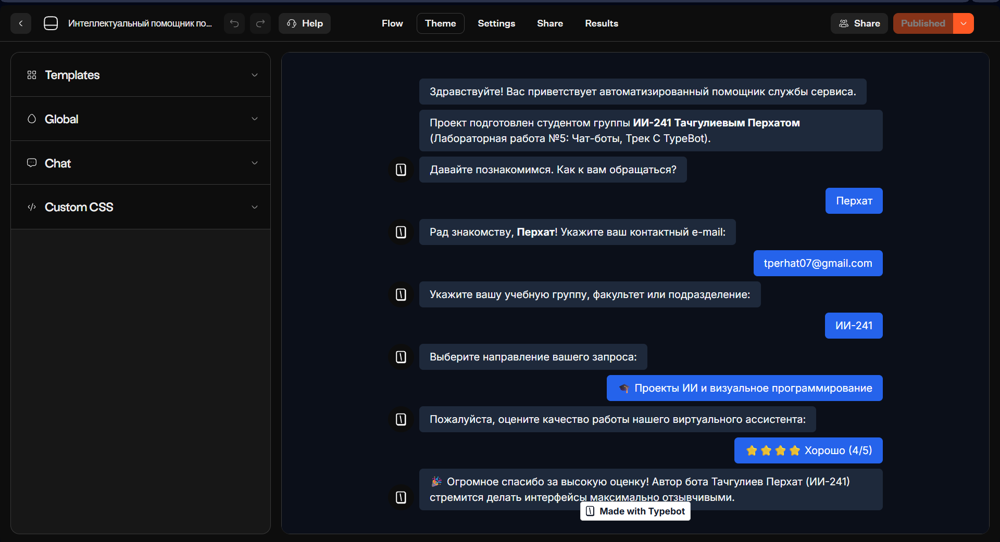

# Лабораторная работа №5. Чат-боты

**Студент:** Тачгулиев Перхат  
**Группа:** ИИ-241  
**Выбранный трек:** Трек C. TypeBot  
**Ссылка на опубликованного бота:** [https://typebot.co/241-ujam1wm](https://typebot.co/241-ujam1wm)

---

## 1. Краткое описание выбранного трека
В рамках лабораторной работы была выбрана low-code платформа **TypeBot (Трек C)**. За основу был взят шаблон лидогенерации и технической поддержки (*Lead Generation & Support Bot*), который был полностью русифицирован и адаптирован под учебный проект студента группы **ИИ-241 Тачгулиева Перхата**.

В сценарий были внесены следующие изменения:
1. **Полная русификация:** переведены все текстовые блоки, кнопки выбора, плейсхолдеры полей ввода и сообщения валидации.
2. **Добавлены новые блоки и шаги:**
   - шаг ввода учебной группы / подразделения (`studentGroup`);
   - шаг оценки качества работы виртуального ассистента по шкале от 1 до 5 звёзд (`satisfactionRating`);
   - дополнительная ветка сбора пожеланий и обратной связи (`feedbackNotes`).
3. **Работа с переменными (`Variables`):** настроены и связаны переменные `userName`, `userEmail`, `studentGroup`, `selectedService`, `satisfactionRating`, `feedbackNotes`.
4. **Условие (`Condition`):** добавлен логический блок проверки оценки (`IF satisfactionRating contains ⭐⭐⭐⭐`), разделяющий сценарий на ветку высокой оценки (7A) и ветку сбора предложений по улучшению (7B).
5. **Интеграция (`HTTP Request / Webhook`):** настроен блок отправки собранных данных POST-запросом на тестовый эндпоинт `https://httpbin.org/post`.
6. **Смена темы и брендинга (`Theme`):** применена кастомная тёмная тема оформления (Slate / Blue).

---

## 2. Ссылки на бота и JSON-экспорты
- **Опубликованный чат-бот (Web):** [https://typebot.co/241-ujam1wm](https://typebot.co/241-ujam1wm)
- **Исходный шаблон (до изменений):** [`lab5/exports/flow-01-template.json`](../exports/flow-01-template.json)
- **Итоговый сценарий (после изменений):** [`lab5/exports/flow-01-Tachguliev.json`](../exports/flow-01-Tachguliev.json)

---

## 3. Ключевые AI-промпты, использованные в работе
1. `"Русифицируй JSON-шаблон TypeBot v6 (все текстовые блоки, кнопки, плейсхолдеры и сообщения об ошибках), добавив персонализацию автора: Тачгулиев Перхат, группа ИИ-241, без нарушения связей и ID переменных."`
2. `"Добавь в сценарий TypeBot два новых шага: ввод учебной группы (переменная studentGroup) и выбор оценки качества обслуживания со звёздами (переменная satisfactionRating)."`
3. `"Спроектируй блок Condition в TypeBot: если переменная satisfactionRating содержит 4 или 5 звёзд — направить диалог в блок благодарности (7A), иначе (Else) — запросить обратную связь в блоке 7B (переменная feedbackNotes)."`
4. `"Настрой блок HTTP Request / Webhook в TypeBot для отправки POST-запроса с переменными userName, userEmail, studentGroup и selectedService на адрес https://httpbin.org/post."`

---

## 4. Освоенные блоки, ноды и элементы
- **Text (Bubbles):** вывод сообщений бота с динамической подстановкой переменных (`{{userName}}`, `{{studentGroup}}`, `{{selectedService}}`, `{{userEmail}}`).
- **Text Input:** сбор текстовых ответов пользователя (ФИО, группа, пожелания) с настроенными русскими плейсхолдерами.
- **Email Input:** ввод электронной почты с проверкой корректности формата.
- **Buttons (Choice Input):** интерактивные кнопки для выбора категории обращения и оценки сервиса.
- **Variables:** хранение и передача пользовательских данных между шагами сценария и во внешний вебхук.
- **Condition:** логическое ветвление сценария по условию `Contains`.
- **HTTP Request / Webhook:** интеграция со сторонним сервером методом `POST`.

---

## 5. Скриншоты выполнения работы

### 5.1. Рабочее пространство (Workspace) в TypeBot

### 5.2. Исходный шаблон «До» русификации

### 5.3. Общий вид сценария «После» внесения изменений

### 5.4. Русифицированные блоки и привязка переменных (шаги 1–5)

### 5.5. Настройка логического ветвления `Condition` (шаги 6, 7A, 7B)

### 5.6. Настройка интеграции `HTTP Request / Webhook` (шаг 8)

### 5.7. Настройка кастомной тёмной темы оформления (`Theme`)

### 5.8. Результат тестирования опубликованного чат-бота

---

## 6. Выводы
В ходе выполнения лабораторной работы я освоил платформу визуального программирования чат-ботов **TypeBot**. Были изучены принципы построения диалоговых сценариев на основе графа блоков, локализации шаблонов, работы с переменными для персонализации ответов, создания условных переходов (`Condition`) в зависимости от действий пользователя, а также отправки собранных лидов во внешние сервисы с помощью `HTTP Request / Webhook`. Готовый бот опубликован по веб-ссылке и экспортирован в формат JSON.
