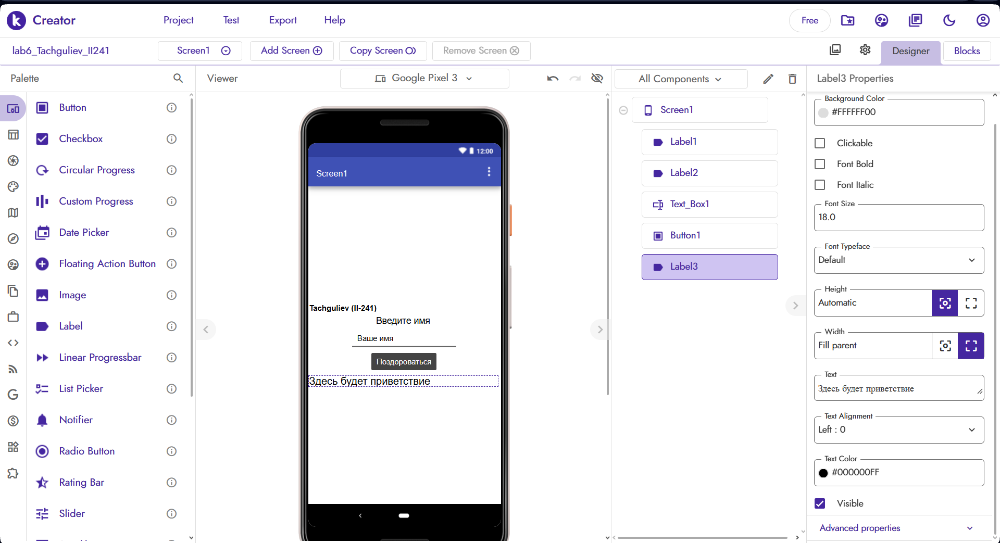
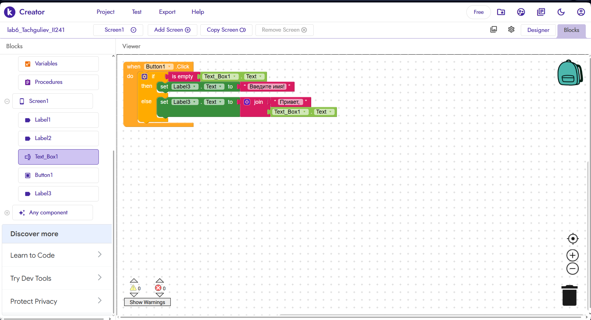

# Лабораторная работа №6. Kodular

**Студент:** Тачгулиев Перхат  
**Группа:** ИИ-241  
**Проект:** `lab6_Tachguliev_II241`  
**Экспорт проекта (.aia):** [`lab6/exports/lab6-Tachguliev.aia`](../exports/lab6-Tachguliev.aia)

---

## 1. Краткое описание приложения
В рамках лабораторной работы на low-code платформе **Kodular Creator** разработано мобильное приложение «Приветствие» (`lab6_Tachguliev_II241`).

На главном экране (`Screen1`) размещены:
- `Label1` — идентификатор автора на английском языке: **`Tachguliev (II-241)`**;
- `Label2` — заголовок поля ввода: **`Введите имя`**;
- `Text_Box1` — текстовое поле ввода имени со свойством `Hint = Ваше имя`;
- `Button1` — кнопка действия **`Поздороваться`**;
- `Label3` — текстовое поле для вывода результата (начальное значение: **`Здесь будет приветствие`**).

При нажатии на кнопку `Button1` выполняется проверка введённого текста через условный блок `if / then / else`:
- если поле `Text_Box1.Text` пустое (`is empty`), в `Label3` выводится предупреждение **«Введите имя!»**;
- иначе с помощью блока соединения строк (`join`) формируется и выводится персональное приветствие **«Привет, <имя>!»**.

---

## 2. Ссылка на проект и файл экспорта
- **Файл экспорта проекта (.aia):** [`lab6/exports/lab6-Tachguliev.aia`](../exports/lab6-Tachguliev.aia)

---

## 3. Освоенные компоненты и блоки
### Визуальные компоненты (Designer):
- **Screen1** — настройка выравнивания контейнера экрана (`Align Horizontal: Center`, `Align Vertical: Center`);
- **Label** — отображение статического текста (ФИО автора, заголовок) и динамического результата;
- **Text Box** — ввод пользовательского текста с подсказкой (`Hint`);
- **Button** — обработка нажатий пользователя.

### Блоки логики (Blocks):
- **`when Button1.Click do`** — обработчик события нажатия на кнопку;
- **`if / then / else` (Control)** — условное ветвление логики;
- **`is empty` (Text)** — проверка строки на пустоту;
- **`join` (Text)** — конкатенация (соединение) нескольких текстовых строк;
- **`Text_Box1.Text` / `set Label3.Text to`** — чтение введённого значения и запись результата в компонент экрана.

---

## 4. Примеры использованных AI-промптов
1. `"Как в Kodular сделать так, чтобы при нажатии на кнопку проверялось, пустое ли текстовое поле, и выводилось сообщение?"`
2. `"Как выровнять все элементы по центру экрана Screen1 в режиме Designer в Kodular?"`
3. `"Как добавить секцию else в блок условного оператора if в редакторе блоков Kodular?"`

---

## 5. Скриншоты выполнения работы

### 5.1. Экран дизайнера (`Screen1`) с видимой фамилией автора

### 5.2. Блоки базовой логики (`Blocks`)

---

## 6. Ограничения бесплатного тарифа Kodular
При работе на бесплатном тарифе (**Kodular Free**) действуют следующие ограничения платформы:
- **Лимит проектов:** не более **10 проектов** на одном аккаунте;
- **Лимит ассетов (медиафайлов):** максимальный объём загружаемых ресурсов проекта — до **10 МБ**;
- **Лимит расширений (Extensions):** не более **5 сторонних расширений (`.aix`)** в проекте.

---

## 7. Выводы
В ходе выполнения лабораторной работы я освоил базовые принципы разработки мобильных приложений под Android в визуальной среде **Kodular Creator**. Научился работать в режиме дизайнера интерфейса (`Designer`), настраивать свойства компонентов (`Label`, `Text Box`, `Button`), а также программировать событийную логику в режиме блочного конструктора (`Blocks`) с использованием условий (`if / then / else`) и строковых операций (`is empty`, `join`). Готовый проект экспортирован в формат `.aia`.
