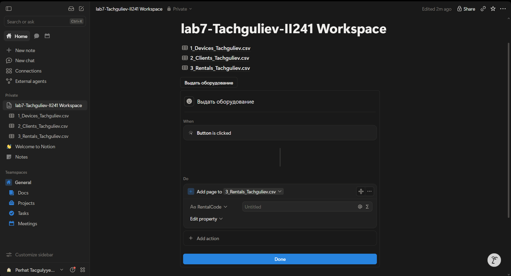
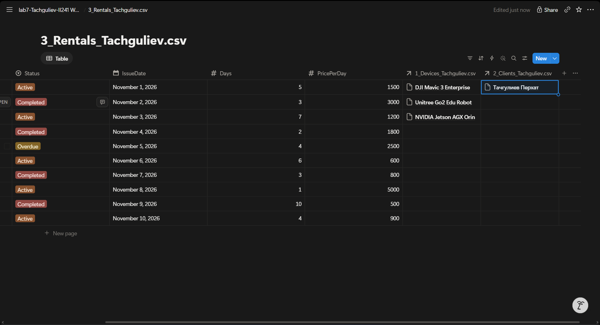
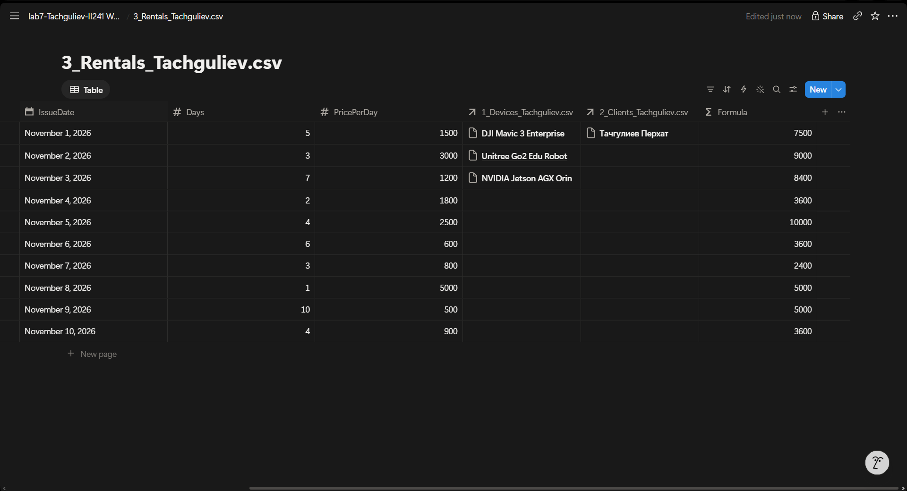
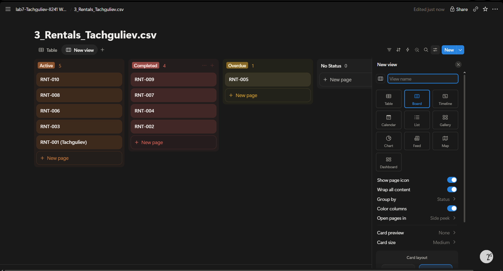

# Лабораторная работа №7. Notion

**Студент:** Тачгулиев Перхат  
**Группа:** ИИ-241  
**Рабочее пространство:** `lab7-Tachguliev-II241 Workspace`  
**Опубликованная страница Notion:** [https://diligent-answer-3b3.notion.site/lab7-Tachguliev-II241-Workspace-4172744ada24803994f7cc2c3a7c61fa](https://diligent-answer-3b3.notion.site/lab7-Tachguliev-II241-Workspace-4172744ada24803994f7cc2c3a7c61fa)  
**Файл экспорта:** [`lab7/exports/lab7-Tachguliev.md`](../exports/lab7-Tachguliev.md)

---

## 1. Описание предметной области и генерация модели данных через ИИ

### 1.1. Использованный промпт для ИИ
> `«Придумай уникальную предметную область для учебного проекта в Notion (прокат оборудования и робототехники в ИИ-лаборатории). Нужно 3 связанные сущности, минимум 2 связи Relation, свойства типов Title, Select, Date, Number, Formula. Опиши модель данных и объясни, зачем нужна каждая связь».`

### 1.2. Сгенерированная ИИ схема (ответ ИИ)
Предметная область — **«Система учёта выдачи оборудования, дронов и ИИ-комплектов в студенческой лаборатории»**:
1. **Сущность 1: `Devices_Tachguliev` (Оборудование)**
   - `Name` (*Title*) — название устройства (DJI Mavic 3, Unitree Go2, NVIDIA Jetson и др.);
   - `Category` (*Select*) — категория (`Drone`, `Robotics`, `AI Kit`, `Sensor`);
   - `DailyRate` (*Number*) — суточная стоимость аренды/оценки;
   - `Condition` (*Select*) — техническое состояние (`Available`, `In Use`, `Maintenance`).
2. **Сущность 2: `Clients_Tachguliev` (Студенты-арендаторы)**
   - `StudentName` (*Title*) — ФИО студента;
   - `Group` (*Select*) — учебная группа (`ИИ-241`, `ИИ-242`, `ИИ-243`);
   - `Rating` (*Number*) — рейтинг ответственности арендатора (от 1 до 5).
3. **Сущность 3: `Rentals_Tachguliev` (Журнал выдачи оборудования)**
   - `RentalCode` (*Title*) — уникальный код выдачи (`RNT-001 (Tachguliev)` ... `RNT-010`);
   - `Status` (*Select*) — статус аренды (`Active`, `Completed`, `Overdue`);
   - `IssueDate` (*Date*) — дата выдачи устройства;
   - `Days` (*Number*) — количество дней аренды;
   - `PricePerDay` (*Number*) — тариф за день;
   - `1_Devices_Tachguliev` (*Relation*) — связь с таблицей оборудования (показывает, какое именно устройство выдано);
   - `2_Clients_Tachguliev` (*Relation*) — связь с таблицей студентов (показывает, кто получил оборудование);
   - `Formula` (*Formula*) — вычисляемое поле итоговой стоимости аренды: `prop("Days") * prop("PricePerDay")`.

### 1.3. Что было исправлено и уточнено после проверки схемы
1. В исходном предложении ИИ итоговая стоимость в таблице `Rentals` рассчитывалась напрямую из связанной базы без учёта фиксированного тарифа на момент выдачи — для упрощения и точности расчёта в базу `3_Rentals_Tachguliev` было добавлено числовое поле `PricePerDay`, а формула приведена к виду `Days * PricePerDay`.
2. Поле `Group` в базе `2_Clients_Tachguliev` переведено из обычного текста в тип `Select` с цветовой кодировкой учебных групп (`ИИ-241`, `ИИ-242`, `ИИ-243`).
3. Для базы `3_Rentals_Tachguliev` добавлено второе представление **Канбан-доска (`Board`)** с группировкой по свойству `Status` (`Active`, `Completed`, `Overdue`).

---

## 2. Освоенные компоненты и настройки Notion
- **Базы данных (Databases):** создание и импорт 3 таблиц по 10 записей в каждой.
- **Типы свойств (Properties):** `Title`, `Select`, `Date`, `Number`, `Relation`, `Formula`.
- **Связи (`Relation`):** двусторонние связи журнала выдачи с базой оборудования и базой студентов.
- **Формулы (`Formula 2.0`):** автоматический расчёт произведения `Days * PricePerDay`.
- **Представления (`Views`):** табличное представление (`Table`) и канбан-доска (`Board`) с группировкой по статусу.
- **Кнопка автоматизации (`Button`):** кнопка **«Выдать оборудование»** на главной странице с действием `Add page to 3_Rentals_Tachguliev`.
- **Публикация в веб (`Share -> Publish to web`):** открытие публичного доступа к рабочему пространству по ссылке.

---

## 3. Ключевые AI-промпты, использованные в работе
1. `"Придумай уникальную предметную область для учебного проекта в Notion. Нужно 3 связанные сущности, минимум 2 связи Relation, свойства типов Title, Select, Date, Number, Formula."`
2. `"Сгенерируй по 10 реалистичных записей в формате CSV для трех баз данных Notion: оборудование ИИ-лаборатории, студенты и журнал аренды."`
3. `"Как в Notion настроить кнопку Button, которая автоматически создает новую запись в выбранной базе данных?"`

---

## 4. Скриншоты выполнения работы

### 4.1. Главная страница `lab7-Tachguliev-II241 Workspace` и настройка кнопки `Button`

### 4.2. База данных и настроенные связи `Relation`

### 4.3. Вычисляемое свойство `Formula` (`Days * PricePerDay`)

### 4.4. Второе представление базы данных — Канбан-доска (`Board`)

---

## 5. Ограничения бесплатного тарифа Notion
На бесплатном персональном тарифе (**Notion Free**) действуют следующие ограничения:
- лимит на размер одного загружаемого файла — **до 5 МБ**;
- история версий страниц (Page history) ограничена **7 днями**;
- ограничение на приглашение гостей и командную работу в рамках одного Workspace;
- базовые лимиты на встроенные автоматизации баз данных.

---

## 6. Выводы
В ходе лабораторной работы я освоил платформу **Notion** как инструмент проектирования реляционных баз данных и управления проектами без написания кода. С помощью ИИ была спроектирована и проверена модель данных из 3 сущностей, реализованы связи `Relation`, вычисляемое поле `Formula`, кнопка быстрого добавления записи `Button` и несколько представлений данных (`Table` и `Board`).
