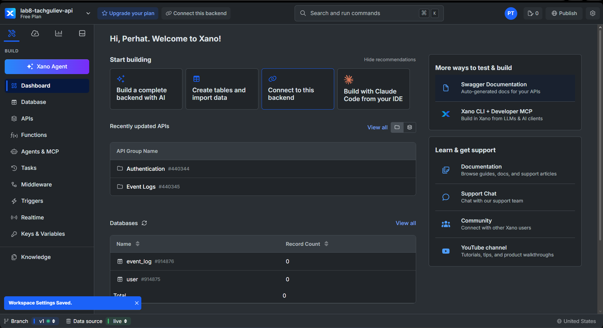
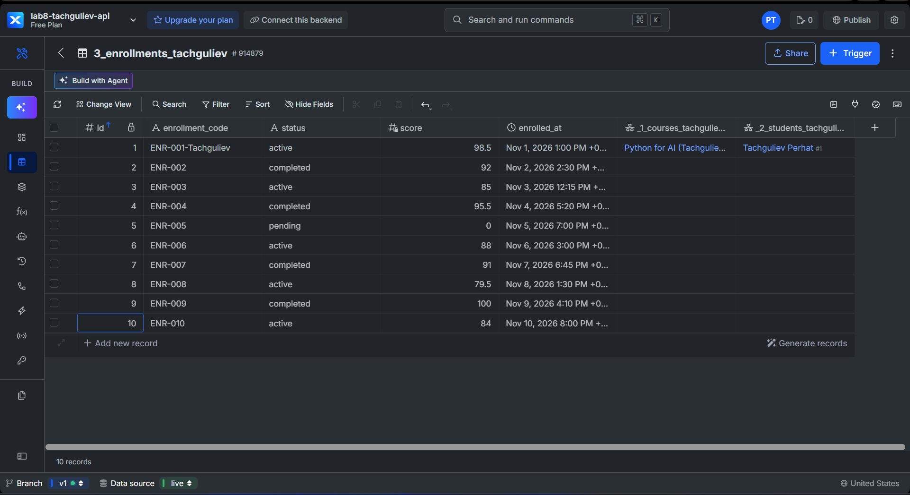
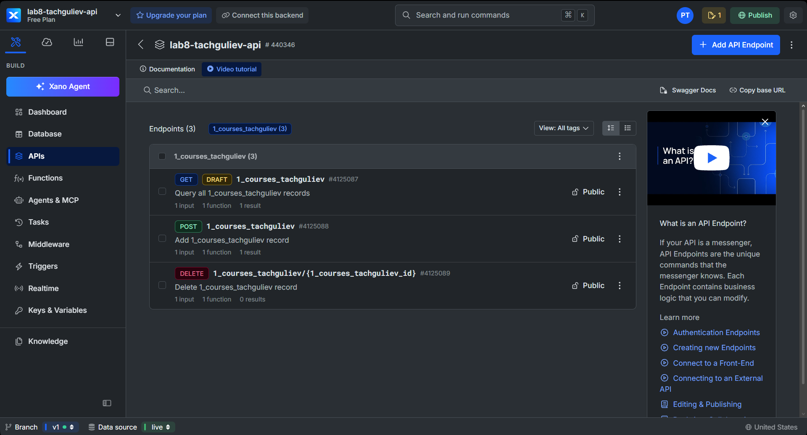
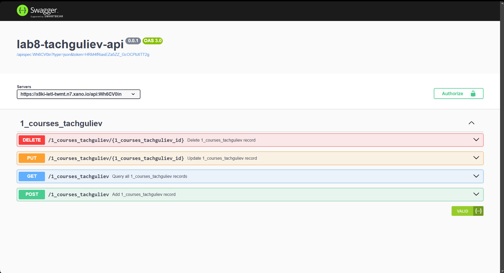

# Лабораторная работа №8. Xano

**Студент:** Тачгулиев Перхат  
**Группа:** ИИ-241  
**Workspace:** `lab8-tachguliev-api`  
**Базовый URL API:** `https://x8ki-letl-twmt.n7.xano.io/api:Wh6CV0in`  
**Ссылка на опубликованный Swagger:** [Открыть Swagger Documentation](https://x8ki-letl-twmt.n7.xano.io/apidoc:Wh6CV0in?token=HRM4fRiasEZa5ZZ_GcOCPbXTT2g)  
**Экспорт спецификации:** [`lab8/exports/lab8-Tachguliev-swagger.json`](../exports/lab8-Tachguliev-swagger.json)

---

## 1. Генерация модели данных и API через ИИ

### 1.1. Использованный промпт для ИИ
> `«Придумай уникальную предметную область для учебного бэкенда на Xano (платформа онлайн-курсов по ИИ и робототехнике). Нужно 3 связанные таблицы, минимум 2 связи reference, поля типов text, integer, decimal, boolean, timestamp, enum, reference. Опиши модель данных и предложи 4 REST-эндпоинта: список, создание, обновление и удаление. Укажи, где используются path- и query-параметры».`

### 1.2. Сгенерированная ИИ схема (ответ ИИ)
Предметная область — **«Бэкенд образовательной платформы курсов ИИ (`lab8-tachguliev-api`)»**:

1. **Таблица 1: `1_courses_tachguliev` (Курсы)** — 10 записей:
   - `id` (*integer*) — первичный ключ;
   - `title` (*text*) — название курса (`Python for AI (Tachguliev)` и др.);
   - `hours` (*integer*) — объём курса в часах;
   - `price` (*decimal*) — стоимость курса (`49.99`, `59.50` и т.д.);
   - `is_active` (*boolean*) — открыт ли набор на курс (`true` / `false`).
2. **Таблица 2: `2_students_tachguliev` (Студенты)** — 10 записей:
   - `id` (*integer*) — первичный ключ;
   - `full_name` (*text*) — ФИО студента (`Tachguliev Perhat` и др.);
   - `study_group` (*text*) — учебная группа (`II-241`, `II-242`, `II-243`);
   - `semester` (*integer*) — номер семестра.
3. **Таблица 3: `3_enrollments_tachguliev` (Записи на курсы)** — 10 записей:
   - `id` (*integer*) — первичный ключ;
   - `enrollment_code` (*text*) — код заявки (`ENR-001-Tachguliev` ... `ENR-010`);
   - `status` (*enum / text*) — статус прохождения (`active`, `completed`, `pending`);
   - `score` (*decimal*) — итоговый балл студента (`98.5`, `92.0` и т.д.);
   - `enrolled_at` (*timestamp*) — дата и время записи на курс;
   - `1_courses_tachguliev_id` (*table reference*) — связь №1 с таблицей курсов;
   - `2_students_tachguliev_id` (*table reference*) — связь №2 с таблицей студентов.

### 1.3. Набор REST-эндпоинтов (группа `lab8-tachguliev-api`)
1. **`GET /1_courses_tachguliev`** — получение списка всех курсов с поддержкой **query-параметра** `search` (*text*).
2. **`POST /1_courses_tachguliev`** — создание новой записи курса в таблице.
3. **`PUT /1_courses_tachguliev/{1_courses_tachguliev_id}`** — обновление данных курса по его ID с использованием **path-параметра** `{1_courses_tachguliev_id}`.
4. **`DELETE /1_courses_tachguliev/{1_courses_tachguliev_id}`** — удаление записи курса по **path-параметру** `{1_courses_tachguliev_id}`.

### 1.4. Что было исправлено и уточнено после проверки схемы
1. В исходном ответе ИИ для цены курса (`price`) и балла (`score`) предлагался целочисленный тип `integer` — в Xano они были заменены на тип с плавающей точкой **`decimal`**, чтобы корректно хранить дробные значения (`49.99`, `98.5`).
2. В эндпоинт `GET /1_courses_tachguliev` вручную добавлен входной query-параметр `search` в блоке `Inputs` для выполнения требования по параметрам запроса.
3. В таблице `3_enrollments_tachguliev` настроены две явные внешние связи типа **`Table Reference`** к таблицам `1_courses_tachguliev` и `2_students_tachguliev`.

---

## 2. Освоенные компоненты и настройки Xano
- **Database Tables:** создание и импорт 3 связанных таблиц по 10 записей в каждой.
- **Типы данных полей:** `text`, `integer`, `decimal`, `boolean`, `timestamp`, `enum/status`, `table reference`.
- **Table Reference:** настройка реляционных связей между таблицей записей на курс и таблицами курсов/студентов.
- **API Groups & Endpoints:** создание группы `lab8-tachguliev-api` и 4 CRUD-эндпоинтов (`GET`, `POST`, `PUT`, `DELETE`).
- **Inputs & Function Stack:** настройка `path`-параметра (`{1_courses_tachguliev_id}`) и `query`-параметра (`search`).
- **Swagger (OpenAPI 3.0):** автоматическая генерация и публикация интерактивной документации API.

---

## 3. Ключевые AI-промпты, использованные в работе
1. `"Придумай уникальную предметную область для учебного бэкенда на Xano. Нужно 3 связанные таблицы, минимум 2 связи reference и 4 REST-эндпоинта CRUD."`
2. `"Сгенерируй по 10 тестовых записей в формате CSV для таблиц курсов ИИ, студентов и журнала записей на курсы в Xano."`
3. `"Как в Xano добавить входной query-параметр в блок Inputs для GET-эндпоинта?"`

---

## 4. Скриншоты выполнения работы

### 4.1. Главный экран (`Dashboard`) воркспейса `lab8-tachguliev-api`

### 4.2. Таблица базы данных (10 записей) и настроенные связи `Table Reference`

### 4.3. Созданные 4 REST API эндпоинта (`GET`, `POST`, `DELETE`, `PUT`)

### 4.4. Документация `Swagger` с видимой фамилией (`lab8-tachguliev-api`)

---

## 5. Ограничения бесплатного тарифа Xano
На бесплатном тарифе (**Xano Free / Build Plan**) действуют следующие ограничения:
- **Недоступность Middleware и Database Triggers** для фоновой обработки событий;
- **Лимит на количество записей** в базе данных (до 100 000 записей на воркспейс);
- **Ограничение частоты запросов (Rate Limit)** на бесплатном сервере;
- **Лимит на отправку писем** (до 100 email-сообщений) и ограничение на экспорт архива всего воркспейса.

---

## 6. Выводы
В ходе выполнения лабораторной работы я освоил no-code/low-code платформу **Xano** для создания серверной части приложений (Backend). Была спроектирована и развёрнута реляционная база данных из 3 таблиц с различными типами полей и связями `Table Reference`, настроены 4 REST API эндпоинта (`GET`, `POST`, `PUT`, `DELETE`), использующие `path`- и `query`-параметры, а также изучена автогенерируемая документация **Swagger (OpenAPI 3.0)**.
